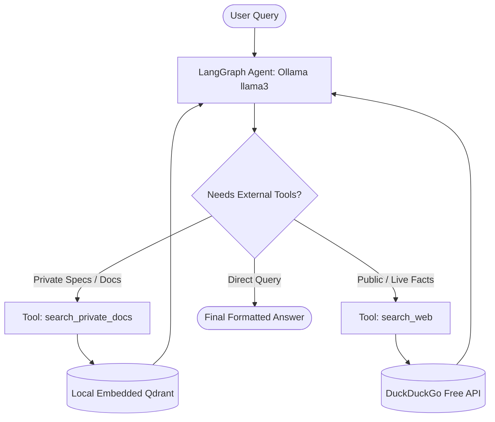

# 🔍 LocalLens: Autonomous 100% Offline Research Agent

> An air-gapped, zero-API-cost research assistant powered by **Ollama**, **LangGraph**, and **Qdrant**.

LocalLens combines private document retrieval (RAG) with autonomous web search. Using local open-source models, it inspects your queries and decides whether to consult your confidential local documents (PDFs/notes) or gather real-time public intelligence from the web.

---

## 🌟 Key Features

* **💰 100% Free & Zero-API-Cost:** No OpenAI, Claude, or Google Cloud credits required. Runs completely on local hardware.
* **🔒 Privacy-First / Air-Gap Capable:** Reads confidential PDFs and notes through an embedded Qdrant database (runs directly on disk without Docker).
* **🧠 Autonomous ReAct Architecture:** Implemented via **LangGraph** with dynamic tool calling and state cycles.
* **🌐 Hybrid Knowledge:** Seamlessly blends private enterprise specs with live web search (**DuckDuckGo**).
* **⚡ Production API:** Clean FastAPI interface with interactive Swagger UI and step-by-step reasoning logs.

---

## 🏗️ Architecture



---

## 📁 Project Structure

```text
local_research_agent/
├── data/
│   └── docs/                # Drop your internal PDFs, .txt, or .md files here
├── src/
│   ├── ingestion.py         # PDF parser, chunker & local Qdrant indexer
│   ├── tools.py             # Private document & DuckDuckGo search tools
│   ├── state.py             # LangGraph state schema
│   ├── agent.py             # ReAct workflow & decision graph
│   └── api.py               # FastAPI web server
├── .gitignore
├── requirements.txt
└── README.md
```

---

## 🚀 Quickstart Guide

### 1. Prerequisites
Ensure you have [Ollama](https://ollama.com) installed.

Pull the generation model and embedding model:
```bash
ollama pull llama3
ollama pull nomic-embed-text
```

### 2. Install Python Dependencies
```bash
cd local_research_agent
pip install -r requirements.txt
```

### 3. Ingest Your Private Documents
Add your PDF, `.txt`, or `.md` files into the `data/docs/` directory, then run:
```bash
python -m src.ingestion
```
*(This parses your files, generates embeddings using `nomic-embed-text`, and builds a local Qdrant database in `qdrant_db/`).*

### 4. Run the API Server
```bash
uvicorn src.api:app --reload
```
Open **[http://127.0.0.1:8000/docs](http://127.0.0.1:8000/docs)** to test via the interactive Swagger UI!

---

## 🧪 Testing the Agent

### Example 1: Querying Confidential Internal Specs
**Request:**
```bash
curl -X POST "http://127.0.0.1:8000/research" \
     -H "Content-Type: application/json" \
     -d '{"query": "What are the fail-safe battery triggers and flight time for Project Apollo?"}'
```

**Agent Behavior:**
1. The agent identifies the query is about an internal project.
2. Invokes `search_private_docs`.
3. Returns accurate specs cited from `project_apollo_specs.txt`.

### Example 2: Querying Public / Real-time Web Knowledge
**Request:**
```bash
curl -X POST "http://127.0.0.1:8000/research" \
     -H "Content-Type: application/json" \
     -d '{"query": "What were the main highlights from the latest Python 3.13 release?"}'
```

**Agent Behavior:**
1. The agent recognizes this is public programming news not found in private specs.
2. Invokes `search_web`.
3. Synthesizes a factual answer with source URLs.

---

## 📦 Pushing to Personal GitHub

```bash
git init
git add .
git commit -m "feat: initial commit of LocalLens autonomous research agent"
git branch -M main
git remote add origin https://github.com/<your-username>/<your-repo-name>.git
git push -u origin main
```

